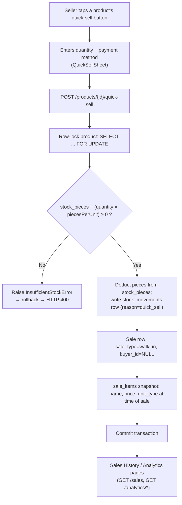
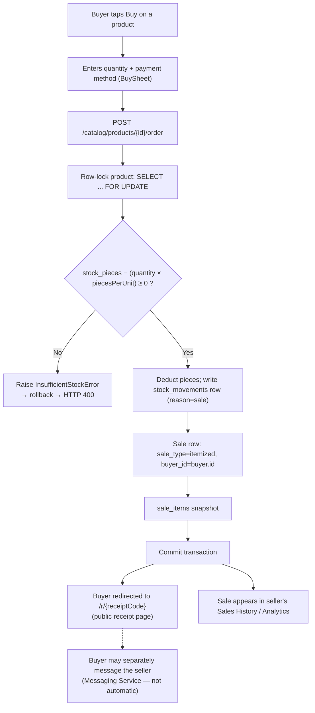

# Data Flow

Two sale paths share the same `sales`/`sale_items` schema and the same stock-deduction primitive
(`services.inventory.apply_stock_change`), but are triggered from different UI surfaces and take
slightly different code paths to get there.

## a) Anonymous walk-in cash sale

Triggered from the seller's **−1** quick-sell button on a product row (`ProductListItem` →
`QuickSellSheet`, `POST /products/{id}/quick-sell`), or from the walk-in path of the checkout cart
(`CheckoutPage`, `POST /sales` with `saleType: "walk_in"`). Both land in code that never sets a
`buyer_id`. The diagram below follows the quick-sell route (`services/inventory.quick_sell`),
which is the single-tap case:

The itemized-cart walk-in path (`services/sales.create_sale`) differs in one important way: it
validates stock for **every** line item first (aggregating duplicate `product_id`s), and only
starts deducting once every line passes — so a multi-item cart either fully succeeds or fully
fails, rather than partially selling out mid-checkout.

## b) Buyer-linked sale

Triggered from the buyer app's **Buy** button on a product detail page (`BuySheet` →
`POST /catalog/products/{id}/order`), which calls the same `services.sales.create_sale` used by
the seller's itemized checkout, with `sale_type="itemized"` and `buyer_id` set to the
authenticated buyer.

!!! note "Deviation from the originally sketched flow"
    There is no "seller confirms" step in the current implementation — placing an order deducts
    stock and completes the sale immediately if stock allows, the same as a seller-rung sale.
    Messaging a seller about an order (`ProductDetailPage` → "Message Seller") is a separate,
    buyer-initiated action, not a system notification triggered by the purchase.
