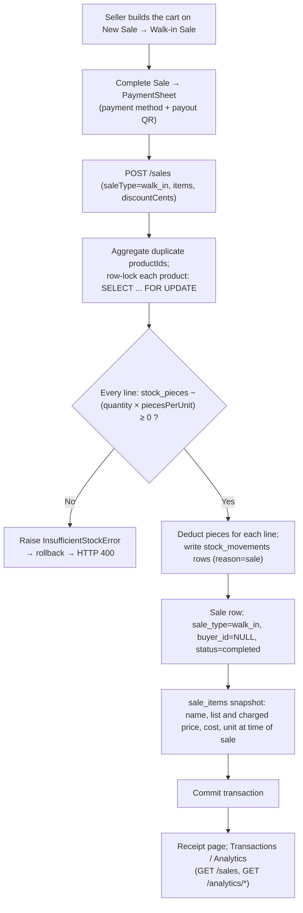
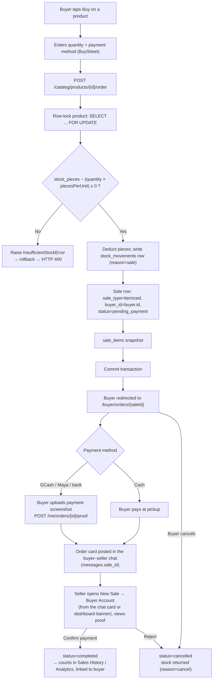

# Data Flow

Two sale paths share the same `sales`/`sale_items` schema and the same stock-deduction primitive
(`services.inventory.apply_stock_change`), but are triggered from different UI surfaces and take
slightly different code paths to get there.

## a) Walk-in sale

Triggered from the seller's **New Sale** screen on the **Walk-in Sale** tab (`CheckoutPage`). The
seller taps product tiles to enter amounts on a number pad (`QuantityPadSheet`), can change a
line's price for this sale (`PriceEditor`) and add a sale-level discount (`CheckoutSummary`), then
taps **Complete Sale**. `PaymentSheet` asks how the buyer paid and shows the seller's matching
payout QR for the customer to scan. Confirming sends `POST /sales` with `saleType: "walk_in"` and
no `buyerId`.

`services/sales.create_sale` validates stock for **every** line item first (aggregating duplicate
`product_id`s), and only starts deducting once every line passes — so a multi-item cart either
fully succeeds or fully fails, rather than partially selling out mid-checkout.

`POST /products/{id}/quick-sell` (`services/inventory.quick_sell`) is a single-product version
of the same path that writes `quick_sell` movements. No screen uses it at the moment (see
[Inventory Service](../api/inventory-service.md)).

## b) Buyer-linked sale

Triggered from the buyer app's **Buy** button on a product detail page (`BuySheet` →
`POST /catalog/products/{id}/order`), which calls the same `services.sales.create_sale` used by
the seller's itemized checkout, with `sale_type="itemized"`, `buyer_id` set to the
authenticated buyer and `status="pending_payment"`. The order reserves stock immediately but
only becomes a counted sale once the seller confirms payment.

!!! note
    Pending and cancelled orders never count in analytics. Analytics bucket a confirmed order by
    its `created_at` (when it was placed), not by when it was confirmed. The order card is posted
    by the backend (`services/messages.post_order_card`) once for a cash order and on every proof
    upload for a digital one. See [Messaging Service](../api/messaging-service.md#order-cards).
