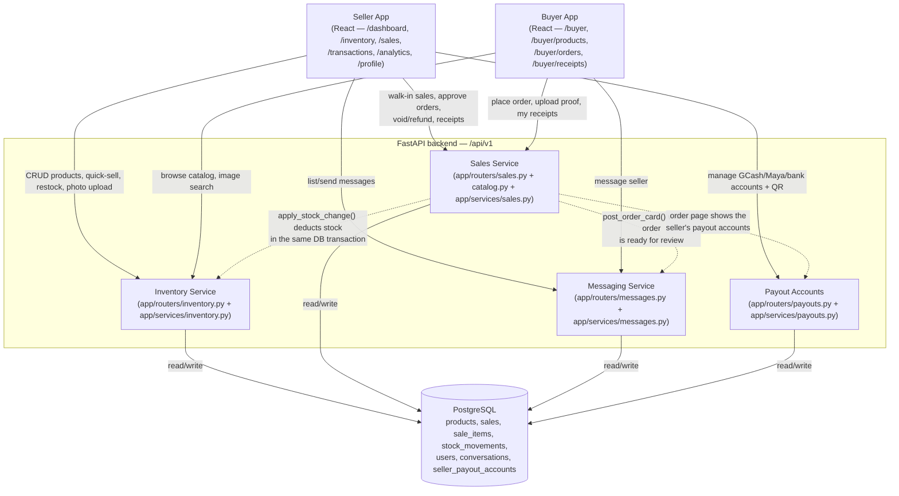

# Architecture Overview

Public Market POS is a single FastAPI application (not separate microservices) whose routers
delegate to distinct service modules — inventory, sales, messaging, payouts, catalog,
analytics — all sharing one PostgreSQL database. The Seller and Buyer apps are two React route trees in the same
frontend codebase, gated by role (`ProtectedRoute role="seller"|"buyer"` in `App.jsx`).

A few things worth calling out:

- **Catalog is buyer-facing inventory + sales, not a fourth service.** `app/routers/catalog.py`
  reads `Product` rows (the same table Inventory owns) for browsing, and calls
  `services.sales.create_sale` directly for the `POST /catalog/products/{id}/order` endpoint (plus
  the `/me/orders/...` proof and cancel endpoints) — it is a thin façade over the other services,
  not an independent domain.
- **Sales never mutates stock directly.** `services/sales.create_sale`, the void, refund,
  reject and cancel paths, and `services/inventory.quick_sell` all call `services.inventory.apply_stock_change`, which is the
  only function allowed to write `Product.stock_pieces`. That function row-locks the product
  (`SELECT ... FOR UPDATE`), rejects changes that would go negative, and writes an append-only
  `stock_movements` row — all in the same transaction as the sale.
- **Auth and Analytics aren't pictured above** for clarity (one process per diagram) — `auth`
  issues JWTs consumed by every other router via `get_current_user`/`require_seller`/
  `require_buyer` (`app/core/deps.py`), and `analytics` (the `app/services/analytics/` package)
  is a read-only aggregation layer over the same `sales`/`products` tables the Sales and
  Inventory services own. It buckets days in `settings.BUSINESS_TIMEZONE` through
  `app/core/business_time.py`.
- **Uploads are shared.** `app/services/uploads.py` validates and saves product photos, payout
  QR codes and payment screenshots to `UPLOAD_DIR`, which `app/main.py` serves at `/uploads`.

See [Data Flow](data-flow.md) for the two sale paths in detail, and
[Unit Conversion](unit-conversion.md) for how `stock_pieces` behaves for piece, bundle and
measure products.
