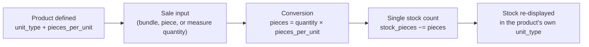

# Unit Conversion

`Product.stock_pieces` is the single source of truth for stock, and it is **always** counted in
individual pieces — regardless of whether the product is sold by the piece, by the bundle, or by
weight. `Product.pieces_per_unit` is the conversion factor between "one selling unit" and "pieces
deducted." Every stock change (quick-sell, itemized sale, restock) computes
`pieces = quantity × pieces_per_unit` and passes that through
`services.inventory.apply_stock_change` — nothing writes `stock_pieces` any other way.

## Worked example — bundle

A seller lists **pandesal** as a `bundle` product with `pieces_per_unit = 25` (one bundle = 25
pieces of bread) and `stock_pieces = 250` (10 bundles on hand).

| Step | Value |
|---|---|
| Buyer/seller sells | 2 bundles |
| Pieces deducted | `2 × 25 = 50` |
| New `stock_pieces` | `250 − 50 = 200` |
| Displayed remaining stock | `200 / 25 = 8 bundles` |

`ProductForm` (`frontend/src/features/inventory/ProductForm.jsx`) labels this field **"Pieces per
Bundle"** and only shows it for `bundle` products — `piece` and `measure` products always send
`pieces_per_unit = 1` and the field is hidden.

## Selling a bundle per piece

A sale line for a `bundle` product can set `byPiece: true` (`SaleItemCreate.by_piece`, and
`BuyRequest.by_piece` for buyer orders). `services.inventory.build_sale_item` then snapshots it as a
**piece** line: `unit_type_snapshot = piece`, list price and cost =
`per_piece_cents(price, pieces_per_unit)` (integer half-up, so ₱100 / 3 = 3333 cents), and
`pieces_deducted = quantity`. Receipts, void/refund/cancel and the forecast read the snapshot and
`pieces_deducted`, so they need no special case. `by_piece` on a non-bundle product raises
`InvalidSaleUnitError` (400). `create_sale` sums `pieces_deducted` per product across lines before
deducting, so a bundle line and a piece line of the same product are validated together.

On the frontend, `saleLineUnit(product, byPiece)` in `features/sales/salesFormat.js` gives a line's
price, cost and unit, and the New Sale cart keys lines by product **and** mode.

Analytics "units sold" still sums `sale_items.quantity`, so a piece line counts like a bundle there.

## Measured products

For `unit_type = "measure"` (meat by the kg, fabric by the yard, rope by the meter, …) the seller
picks the unit, stored as `Product.unit_label` (≤ 16 chars, required for measure products). To
allow fractional amounts without floats, everything quantity-shaped is stored in **thousandths of
that unit** (`MEASURE_QUANTITY_SCALE = 1000` in `services/inventory.py`):

| Field | Meaning for a measure product |
|---|---|
| `stock_pieces` | thousandths of the unit (`50500` = 50.5 yd) |
| `low_stock_threshold` | thousandths of the unit |
| sale / restock `quantity` | thousandths of the unit (`1500` = 1.5 yd) |
| `pieces_per_unit` | always `1` (enforced: 400 otherwise), so stock deducted = quantity |
| `price_cents` | per **whole** unit (`12000` = ₱120/yd) |

Line totals use `line_total_cents(price_cents, quantity, unit_type)` in `services/inventory.py`,
which divides by the scale with integer half-up rounding (`1500 × 12000 / 1000 = 18000`). The
frontend mirrors it as `lineTotalCents` in `frontend/src/lib/format.js`, alongside
`formatQuantity` / `parseQuantityInput` / `sanitizeQuantityInput` for converting between the
stored integer and the decimal text sellers type. `sale_items.unit_label_snapshot` keeps receipts
stable if a product's unit label is edited later.

The migration `c3e1a7d9f2b4` converted the old `grams` ("Per Kilo") type: grams were already
thousandths of a kg, so stock and quantities were kept as-is, `unit_label` set to `kg`, and
per-gram prices multiplied by 1000 to per-kg prices (line totals unchanged).

## Why this matters

Because `stock_pieces` is always pieces, low-stock comparisons (`stock_pieces <=
low_stock_threshold`), the demand forecast, and analytics all operate on one consistent unit
regardless of how a product is sold — there is no unit-mismatch bug possible between "10 bundles
low-stock" and "250 pieces low-stock" because the threshold is also stored in pieces.
