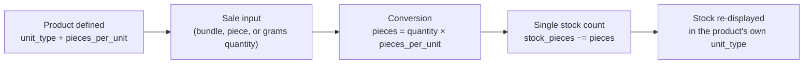

# Unit Conversion

`Product.stock_pieces` is the single source of truth for stock, and it is **always** counted in
individual pieces — regardless of whether the product is sold by the piece, by the bundle, or by
weight. `Product.pieces_per_unit` is the conversion factor between "one selling unit" and "pieces
deducted." Every stock change (quick-sell, itemized sale, restock) computes
`pieces = quantity × pieces_per_unit` and passes that through
`services.inventory.apply_stock_change` — nothing writes `stock_pieces` any other way.

## Worked example — bundle

A seller lists **pandesal** as a `bundle` product with `pieces_per_unit = 25` (one bundle = 25
pieces of bread) and `stock_pieces = 250` (10 bundles on hand).

| Step | Value |
|---|---|
| Buyer/seller sells | 2 bundles |
| Pieces deducted | `2 × 25 = 50` |
| New `stock_pieces` | `250 − 50 = 200` |
| Displayed remaining stock | `200 / 25 = 8 bundles` |

`ProductForm` labels this field **"Pieces per Bundle"** and only shows it for `bundle` and
`grams` unit types (`showPiecesPerUnit` in `frontend/src/features/inventory/ProductForm.jsx`) —
`piece` products default to `pieces_per_unit = 1` and the field is hidden, since one selling unit
already equals one piece.

## Grams products

For `unit_type = "grams"` (e.g. meat, rice sold by weight), `pieces_per_unit` is always `1` in
practice (see `backend/app/seed.py` / `backend/scripts/seed.py`), and `stock_pieces` stores grams
directly rather than a piece count — a seller weighs out `quantity` grams (via `WeighDialog` in
the checkout cart, or `BuySheet` for buyers) and that many grams are deducted 1:1. `price_cents`
for a grams product is priced **per gram**, and the UI displays remaining stock converted to kilos
(`unitSuffix` in `frontend/src/lib/format.js` shows `"kg"` for on-hand stock, while sale line
items are labeled in `"g"` — see `saleUnitLabel` in `frontend/src/features/sales/salesFormat.js`).

## Why this matters

Because `stock_pieces` is always pieces, low-stock comparisons (`stock_pieces <=
low_stock_threshold`), the demand forecast, and analytics all operate on one consistent unit
regardless of how a product is sold — there is no unit-mismatch bug possible between "10 bundles
low-stock" and "250 pieces low-stock" because the threshold is also stored in pieces.
