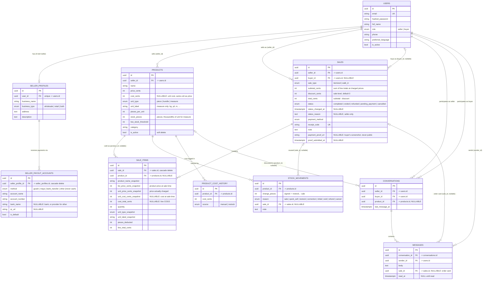

# Database Schema

PostgreSQL, accessed through SQLAlchemy models in `backend/app/models/`. Every table uses a UUID
primary key and UTC-aware timestamps via the shared mixins in `models/mixins.py`
(`UUIDPkMixin`, `CreatedAtMixin`, `UpdatedAtMixin`).

## Why `buyer_id` is nullable

`sales.buyer_id` is nullable because `sale_type = walk_in` (an anonymous cash sale rung up at the
stall, with no buyer account involved) and `sale_type = itemized` (a buyer-linked digital order)
share one table. A walk-in sale simply never sets `buyer_id`; `SaleCreate.check_consistency`
enforces the pairing at the API boundary (`itemized` requires a `buyer_id`, `walk_in` forbids
one). Both sale types deduct stock and count toward analytics identically — no code branches on
`sale_type` for that shared behavior, only for what's required on the way in and what's shown on
receipts (buyer name vs. "Walk-in").

## Other notable design choices

- **`sale_items.product_id` is nullable and the row snapshots `product_name_snapshot`,
  `unit_price_cents_snapshot`, `unit_type_snapshot`, `unit_label_snapshot` at write time.** Products are soft-deleted
  (`is_active = false`) only — never hard-deleted, because `sale_items` (and therefore every past
  receipt) references them by ID. The snapshot columns mean a receipt's wording and price never
  change even if the product is later renamed or re-priced.
- **`stock_movements` is append-only** and is the audit trail for every change to
  `products.stock_pieces`. `services.inventory.apply_stock_change` is the only code path allowed
  to write `stock_pieces`, and it always writes a matching `stock_movements` row (with `sale_id`
  set when the change came from a sale, `null` for a manual restock).
- **`conversations` has a uniqueness constraint on `(seller_id, buyer_id, product_id)`** so
  re-opening a chat about the same product with the same counterpart reuses the existing thread.
- **`sales.status` covers buyer orders too.** A buyer's online order is a normal `itemized` sale
  created as `pending_payment` (stock already reserved), which becomes `completed` when the seller
  confirms payment or `cancelled` (stock returned with a `cancel` movement) when either side
  backs out. Analytics count only `completed` (plus `refunded` for gross sales and refunds).
- **`messages.sale_id`** marks an order card, the message posted from the buyer when their order
  is ready for review. The API attaches the order's live status to it.
- **`seller_payout_accounts.method` reuses the `payment_method` enum**, so a buyer's chosen method
  maps straight to the seller's matching accounts. The schema layer keeps `cash` out.
- **All money is integer cents** (`price_cents`, `total_cents`, etc.) — there are no floating-point
  currency columns anywhere in the schema.
